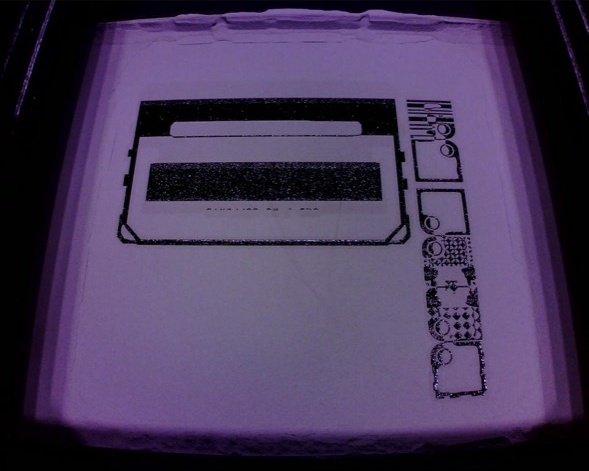

# Formlabs Fuse Camera

Camera integration by **[byfuse3d.com](https://byfuse3d.com/)**.

[](https://my.home-assistant.io/redirect/supervisor_add_addon_repository/?repository_url=https%3A%2F%2Fgithub.com%2Fbyfuse3d%2Fformlabs-fuse-camera)

The button opens Home Assistant with this app repository prefilled. Confirm adding the repository, then install **Formlabs Fuse Camera by byfuse3d.com**. Home Assistant OS is required for the app store.

Local camera streaming for Formlabs Fuse 1 and Fuse 1+ 30W printers, with a Home Assistant app and standalone viewers.

The recommended relay connects directly to the printer's camera WebSocket and serves MJPEG video and JPEG snapshots. It runs on Home Assistant OS, in Docker, or with Python 3.10+. The runtime uses only the Python standard library.

## Camera preview



Actual Fuse 1+ camera feed shown in Home Assistant, cropped to remove the phone interface.

## Home Assistant

The app source is in [`formlabs_fuse_camera/`](formlabs_fuse_camera/README.md). Configure `printer_host` with your printer's address or hostname. The checked-in value `printer.local` is a placeholder; it is not automatically discovered.

Add `https://github.com/byfuse3d/formlabs-fuse-camera` to the Home Assistant app store's repository settings, then install **Formlabs Fuse Camera by byfuse3d.com**. The dashboard example includes a website credit below the camera. An already installed app from another repository keeps its existing repository identity; publishing updates here does not automatically migrate that installation.

## Run with Python

Set `FUSE_PRINTER_HOST` to your printer's address or hostname, then run:

```sh
python formlabs_fuse_camera/relay.py
```

Open `http://localhost:8766/` on that computer. For other computers, use the relay host's hostname instead of `localhost`.

## Docker

Inside `formlabs_fuse_camera`, copy `.env.example` to `.env`, set your printer host, then run `docker compose up -d --build`.

## Endpoints

| Path | Response |
| --- | --- |
| `/` | Browser preview |
| `/stream` | MJPEG stream |
| `/snapshot.jpg` | Current JPEG image |
| `/health` | Connection state, received FPS, frame count, viewers, and frame age |

One upstream printer connection is shared by all HTTP viewers. Frames are requested on an independent timer, with only the latest frame retained. `max_fps` controls request frequency, not guaranteed output FPS. Actual camera FPS depends on the printer and network. The connection closes after the configured idle period and reconnects when needed.

## Source layout

- `formlabs_fuse_camera/`: recommended Python relay, Home Assistant metadata, Docker files, and dashboard example.
- `examples/browser/`: direct WebSocket browser viewer with worker-based image decoding.
- `examples/node/`: earlier Node.js 22+ MJPEG helper and its browser viewer.
- `docs/protocol.md`: camera protocol and refresh timing findings.
- `tests/`: simulated camera integration and browser worker tests.

The examples preserve the earlier reply-paced approach and may stall when a camera refresh receives no reply. Use the Python relay for Home Assistant and reliable continuous capture. Browsers can also restrict direct connections from HTTPS pages to a plain WebSocket printer.

## Tests

```sh
python -m pip install -r requirements-dev.txt
python tests/test_relay.py
node tests/test_browser_worker.cjs
node tests/test_browser_page.cjs
```

Tests use a simulated camera on loopback and require no real printer.

## Privacy and access

Personal network addresses, deployment records, machine paths, and credentials are excluded. The camera preview above is a shared, cropped screenshot; other camera captures are excluded. The bind address `0.0.0.0` and test loopback address `127.0.0.1` are generic networking constants. Set personal values locally in Home Assistant options, environment variables, or an ignored `.env` file.

The relay and observed printer camera endpoint have no built-in authentication. Keep them on a trusted network. This is an independent implementation, unaffiliated with Formlabs. No vendor binaries or decompiled implementation are included.
